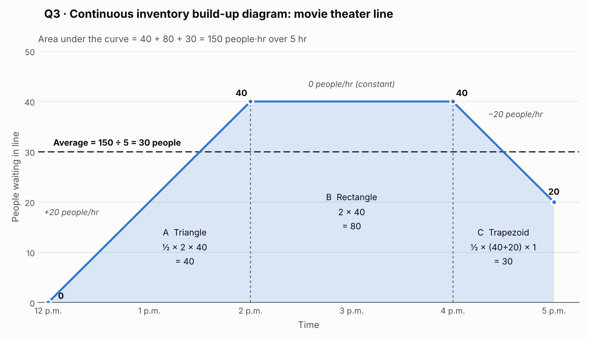

# DOTE 2030 — Homework 1: Process Flow Analysis (Solutions)

*Units are included and final answers are rounded to two decimal places. The process is assumed stable, so Little's Law applies.*

---

## Question 1 — Flow time of the process [1 pt]

The flow time of a process is the shortest time for one flow unit to get through the whole process (Lecture 2). When activities run **simultaneously** (in parallel), the unit can't move on until the **longest** parallel branch is done. So:

- A → (B ∥ C) → D → (E ∥ F) → G

| Stage | Time |
|---|---|
| Activity A | 5 min |
| B ∥ C = max(3, 5) | 5 min |
| Activity D | 2 min |
| E ∥ F = max(5, 7) | 7 min |
| Activity G | 3 min |

**Flow time = 5 + 5 + 2 + 7 + 3 = 22.00 min**

---

## Question 2 — Open-pit mining (Little's Law: I = R × T) [6 pts]

### (a) [3 pts]
- Flow time T = 10 min = 10/60 hr = 1/6 hr
- Throughput rate R = 12 rocks/hr

I = R × T = 12 rocks/hr × (1/6) hr = **2.00 rocks**

### (b) [3 pts]
- The inventory in the process counts flow units in the buffer **and** in the activity (Lecture 3):
  I = 4 + 1 = 5 rocks
- Flow time T = 20 min

R = I / T = 5 rocks / 20 min = **0.25 rocks/min**

---

## Question 3 — Movie theater line (continuous inventory build-up diagram) [5 pts]

**Inventory over time:**
- 12–2 p.m.: the line grows at +20 people/hr, from 0 to 20 × 2 = **40 people**
- 2–4 p.m.: the line stays at **40 people**
- 4–5 p.m.: the line shrinks at −20 people/hr, from 40 to 40 − 20 × 1 = **20 people**

```
People
 40 |        __________
    |      /            \
 20 |    /               |
    |  /                 |
  0 |/___________________|____
    12    1    2    3    4    5   (p.m.)
```



**Area under the curve:**
| Period | Shape | Area |
|---|---|---|
| 12–2 p.m. | Triangle: ½ × 2 hr × 40 | 40 people·hr |
| 2–4 p.m. | Rectangle: 2 hr × 40 | 80 people·hr |
| 4–5 p.m. | Trapezoid: ½ × (40 + 20) × 1 hr | 30 people·hr |
| **Total** | | **150 people·hr** |

Average inventory = area ÷ length of the time period = 150 people·hr ÷ 5 hr = **30.00 people**

---

## Question 4 — Car manufacturing [10 pts]

**Unit loads and capacity rates (original process).** The unit load of a resource is the total time it spends on one flow unit across *all* activities it performs, and capacity rate = 60 ÷ unit load (Lecture 2).

| Resource | Activities | Unit load (min/car) | Capacity rate (cars/hr) |
|---|---|---|---|
| Saw | Cut metal | 30 | 60/30 = 2.00 |
| Employee 1 | Assemble body + Install engine | 40 + 10 = 50 | 60/50 = 1.20 |
| Crane | Install engine | 10 | 60/10 = 6.00 |
| Employee 2 | Quality assurance | 60 | 60/60 = 1.00 |

### (a) [2 pts]
The bottleneck is the resource with the lowest capacity rate (highest unit load).

**Bottleneck: Employee 2**, with a capacity of 1.00 car/hr. The process capacity is 1.00 car/hr.

### (b) [3 pts]
Employees 2 and 3 now form a **resource pool** for quality assurance, so the pool's capacity is 2 × 1.00 = 2.00 cars/hr.

| Resource | Capacity rate (cars/hr) |
|---|---|
| Saw | 2.00 |
| Employee 1 | 1.20 |
| Crane | 6.00 |
| Employee 2 + Employee 3 (pool) | 2.00 |

**Bottleneck: Employee 1**, with a capacity of 1.20 cars/hr. Fixing one bottleneck created another.

### (c) [5 pts]
For the bottleneck to have a capacity of 2 cars/hr, **every** resource must have a capacity ≥ 2 cars/hr. That means every unit load must be ≤ 60/2 = **30 min/car**.

- **Saw:** 30 min, which is exactly 2 cars/hr. ✓ No investment needed (and none is possible).
- **Crane:** 10 min. ✓
- **Employee 2:** QA must go from 60 → 30 min, a reduction of **30 min**, costing 30 × $10 = **$300**.
- **Employee 1:** the unit load is assemble + 10 (the engine time can't be reduced) ≤ 30, so assemble ≤ 20 min. It must go from 40 → 20 min, a reduction of **20 min**, costing 20 × $10 = **$200**.

After investing, the unit loads are Saw 30, Employee 1 20 + 10 = 30, Crane 10 and Employee 2 30. The bottleneck capacity is 60/30 = 2 cars/hr (Saw, Employee 1 and Employee 2 tie). Any smaller investment leaves Employee 1 or Employee 2 above 30 min, so below 2 cars/hr.

**Minimum investment = $300 + $200 = $500.00**

---

## Question 5 — Unit load and capacity [4 pts]

### (a) [3 pts]
Each resource's unit load is the sum of the times of all activities it is required for:
- R1: A + B = 6 + 2 = 8 min
- R2: B + C = 2 + 4 = 6 min
- R3: D = 4 min

| Resource | Unit Load (min/unit) | Capacity Rate (units/hr) |
|---|---|---|
| R1 | 8 | 60/8 = **7.50** |
| R2 | 6 | 60/6 = **10.00** |
| R3 | 4 | 60/4 = **15.00** |

### (b) [1 pt]
- Process capacity = min(7.50, 10.00, 15.00) = 7.50 units/hr, with R1 as the bottleneck
- Throughput rate = min{capacity rate, input rate} = min{7.50, 2} = 2 units/hr
- Utilization of R2 = throughput rate ÷ capacity rate of R2 = 2 ÷ 10 = **20.00%**
